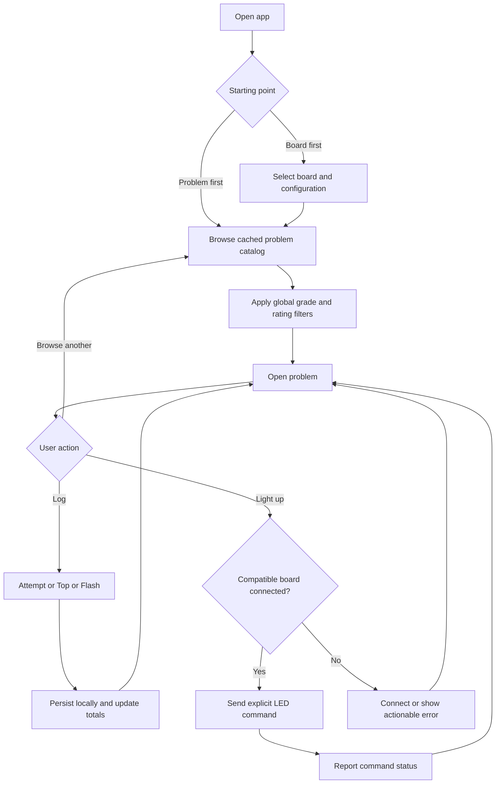
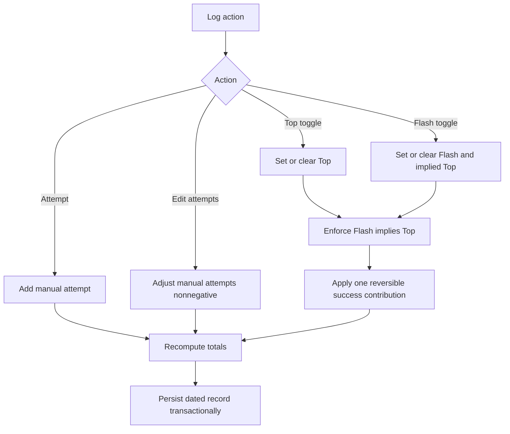
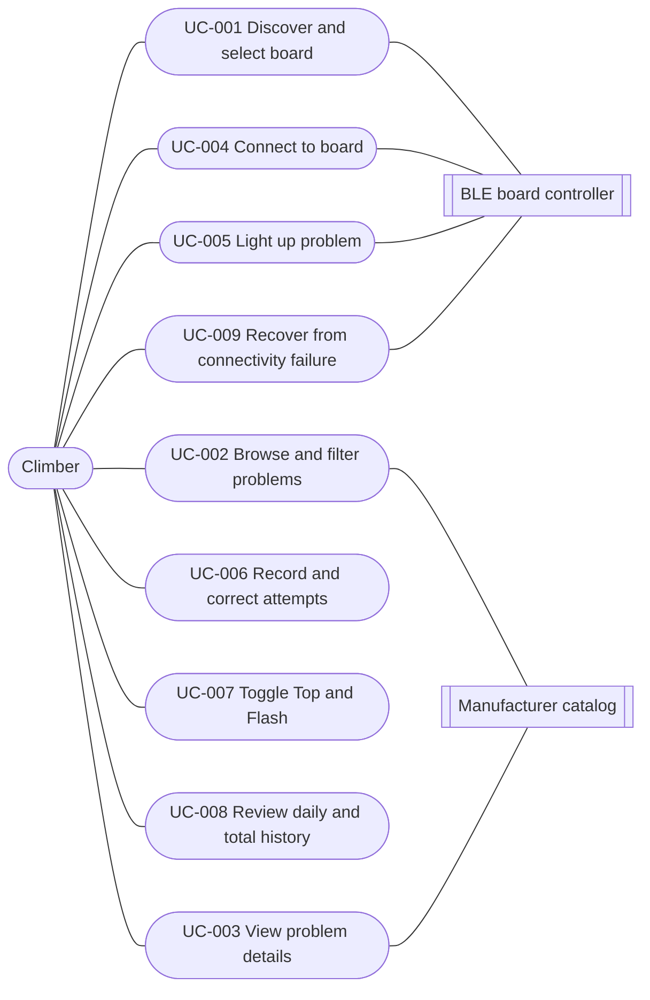

# ADR-0001: Cross-board product experience, browsing, and climbing history

- **Status:** Accepted for product direction; formal requirements and use cases added; technical feasibility tracked separately
- **Date:** 2026-11-16
- **Amended:** 2026-11-18, light on swipe (§2.1 item 7, FR-008, FR-008a, AC-020, acceptance 1), approved by the product owner
- **Decision owners:** Product team
- **Scope:** MVP for Kilter Board, MoonBoard, and Tension Board
- **Related:** [ADR-0002](ADR-0002-react-native-architecture-and-integrations.md)

## 1. Context and problem

Climbers using adjustable LED training boards need to discover problems, illuminate them, and record climbing progress without repeatedly switching manufacturer applications. A shared physical board is often used by several climbers, each exploring problems on their own phone. Browsing must therefore not unexpectedly change the board's LEDs.

The MVP should feel fast and work without an app account. Its model must support multiple board manufacturers without misrepresenting grades or inventing controller capabilities. A possible future TopLogger relationship informs the visual direction and data boundaries but must not dictate the standalone experience.

### Inspiration and references

- **Kilter Board app:** Simple problem selection and lighting interaction; reference for familiar climbing workflows, not a pixel-for-pixel copy.
- **Boardsesh:** Cross-board problem discovery, open-source implementation patterns, and interaction ideas; code/asset reuse subject to license and provenance review.
- **TopLogger:** Possible brand-color inspiration and future ecosystem integration; no claim of affiliation or API compatibility.

## 2. Decision

Build a **local-first, cross-manufacturer climbing companion** with two conceptual modes: discovering a problem and controlling physical board LEDs. Support both **board-first** navigation (choose a board/configuration, then browse compatible problems) and **problem-first** discovery (search/filter, then examine compatible board context where possible).

### 2.1 Browsing and board control

1. Browsing, opening details, filtering, and logging **never change the illuminated problem**, unless the climber switched on light on swipe (item 7).
2. An explicit **Light up** action sends the selected problem's LED mapping to the currently connected compatible board.
3. **Most recent successful command wins**; there is no session ownership, reservation, or lock mechanism in the MVP.
4. Each user browses independently. Support simultaneous phone connections where controllers permit it. When unsupported, the **last-connected phone wins** is the intended fallback, subject to whether controller takeover is technically possible; never claim hardware support without testing.
5. Nearby boards are discovered automatically but **never selected or connected automatically**. The climber explicitly chooses the board; manual configuration is offered when discovery cannot identify it. On reconnect, never automatically resend the last LED pattern. A user must tap **Light up** again.
6. Show connection and lighting command status truthfully. If the controller cannot report the actual LED state, show **last command sent by this device**, not authoritative shared-board state.
7. **Light on swipe** (amended 2026-11-18). A climber alone at the board can switch on light on swipe while this phone is connected. The board then follows the problem on screen: the problem the climber settles on is lit once, without tapping Light up. Switching it on lights the problem on screen. It is off by default, is not stored, and turns off on disconnect or when connecting to a board. A lost link pauses it: reconnecting or resuming relights nothing, and the next problem the climber settles on is lit. The phone cannot tell whether someone else is using the board, so the climber decides when to switch it on.

### 2.2 Climbing-log controls

Provide three controls on the problem detail view:

- **Attempt:** A quick tap adds one attempt. A long press, or an equivalent accessible secondary action, opens an editor with `+` and `−` controls. Never permit negative attempts.
- **Top:** Boolean toggle. Turning it on marks the problem topped and contributes **exactly one** attempt; turning it off removes that contribution.
- **Flash:** Boolean toggle. Turning it on marks both `flash=true` and `top=true` and contributes **exactly one** attempt, not two. Turning it off reverses its contribution according to the state-transition rules below.

**Invariant:** `flash => top`. `Top OFF` always clears Flash. Repeated toggling cannot inflate the attempt count. A successful climb is included in attempt totals.

**Implementation clarification:** Treat the achievement-related attempt contribution as one reversible logical contribution, distinct from manually added attempts. Switching Top to Flash must **not** add a second attempt. If Flash is switched off while Top remains on, retain the single successful-attempt contribution. If both achievements are cleared, remove it. This resolves the ambiguity between 'Flash OFF' and the implied Top achievement while maintaining the user's requirement that toggling on/off cannot inflate the count.

**Examples**

| Interaction | Manual attempts | Successful contribution | Total attempts | Top | Flash |
|---|---:|---:|---:|---|---|
| Tap Attempt twice | 2 | 0 | 2 | No | No |
| Enable Top | 2 | 1 | 3 | Yes | No |
| Disable Top | 2 | 0 | 2 | No | No |
| Enable Flash | 2 | 1 | 3 | Yes | Yes |
| Disable Flash (keep Top) | 2 | 1 | 3 | Yes | No |
| Disable Top | 2 | 0 | 2 | No | No |

A Flash is a **first-ascent achievement**, not a repeatable event. Repeating a previously completed problem does not create additional Tops or Flashes. Attempts may still be added for subsequent climbing. If a climber already has failed attempts recorded for that same problem, enabling Flash is logically inconsistent; the UI should require correcting those attempts or explicitly acknowledge the contradiction rather than silently producing an invalid history. This guardrail is a proposed implementation detail to validate in usability testing.

### 2.3 Sessions and history

- One **local calendar day = one session**, even if a climber visits twice.
- Show **session attempts** (today) and **total attempts** (all days) for the selected problem.
- Preserve historical sessions locally; the current day's controls affect the current day.
- Top/Flash are cumulative problem-level achievements, not repeatable per-session scores. Historical edits need to preserve their original dates.
- Prefer an event/record-based persistence model from which totals can be derived; do not maintain disconnected counters that drift.
- Calendar boundaries use the phone's local timezone at the point of logging; persist an unambiguous timestamp and session date to avoid silently moving historical records after timezone changes.

### 2.4 Search, grades, and catalog freshness

- **Global filters across manufacturers:** Grade range and minimum star rating only in MVP; persist across app restarts.
- Preserve the grade **as published by each manufacturer**. Convert standard display scales (for example Font and V-scale) where reliable; do not adjust for perceived 'soft' or 'hard' board grading.
- Where a manufacturer omits ratings, expose that clearly rather than quietly treating missing ratings as zero.
- Use **stale-while-revalidate**: render cached problems immediately, then refresh in the background.
- **MVP fetch strategy:** fetch problems incrementally (pages/cursors where supported), cache retrieved data in SQLite, show cached results immediately, and refresh in the background. If a manufacturer only supports bulk results, its adapter may fetch and cache the bulk response. Delta synchronization is a later optimization, not an MVP prerequisite.
- Catalog outages do not delete cached problems or climbing history.

### 2.5 Responsiveness and connectivity

The priority is *perceived responsiveness*, measured on real devices:

| Interaction | Provisional target |
|---|---|
| Cached browsing and problem selection | Around 100–500 ms, ideally instant-feeling |
| Button and logging feedback | Immediate UI update, persist locally |
| Connect to nearby compatible board | Aim for 1–2 s under normal conditions; hardware-dependent |
| Light up LEDs | Immediate progress indication; aim for physical change within 1–2 s |

Do not block UI interaction on network or BLE operations. Keep connections alive while locked when platform and controller allow it; reconnect gracefully when lost. OS background restrictions take precedence over aggressive keepalive strategies. Reconnection never changes LEDs by itself.

### 2.6 Data availability, accounts, and privacy

- **No app account required.** On-device storage is the source of truth for MVP records.
- Platform-native backup/restore may be included if low complexity and no proprietary backend is required. Full live cross-platform sync is not an MVP dependency.
- A new phone may not automatically receive records unless device backup/restore is configured; communicate this limitation clearly.
- Request Bluetooth-related permissions only when a relevant connection action requires them, not at initial app launch. Declined permissions must not prevent offline catalog browsing or logging.

## 3. Alternatives considered

| Decision area | Alternative | Evaluation |
|---|---|---|
| LED control | Auto-light as user browses | **Rejected:** disruptive for shared boards |
| Shared access | Board owner / session lock | **Rejected for MVP:** operational complexity and poor social UX |
| Shared access | Latest explicit command wins | **Selected** for LED patterns; concurrent BLE connections depend on hardware. Last-connected-phone takeover is the intended fallback when needed. |
| Logs | Only Top/Flash | **Rejected:** loses failed-attempt history |
| Logs | Separate nonreversible counters | **Rejected:** accidental taps and repeated toggling corrupt totals |
| Sessions | Individual gym visits | **Rejected for MVP:** unnecessary session-start/stop flow |
| Sessions | Calendar-day aggregation | **Selected** |
| Filters | Per-manufacturer saved filters | **Rejected:** users expect grade preferences to follow them |
| Filters | Many advanced criteria | **Deferred:** grade and rating first |
| Catalog | Always fetch before display | **Rejected:** perceptibly slow / breaks offline use |
| Catalog | Manual refresh only | **Rejected:** stale discovery experience |
| Catalog | Cached display + background refresh | **Selected** |
| Backup | Mandatory custom cloud account/backend | **Rejected for MVP:** complexity and account requirement |

## 4. User flows

## 5. Requirements catalogue

The identifiers in this section are stable references for implementation tasks and tests. **MUST** indicates MVP scope unless explicitly labeled conditional or deferred. ADR-0002 owns the technical implementation, while this ADR owns observable product behavior.

### 5.1 Functional requirements (FR)

| ID | Requirement | Acceptance evidence |
|---|---|---|
| FR-001 | The app MUST support Kilter, MoonBoard, and Tension in the first implementation, with manufacturer-specific providers behind shared interfaces. | All three are available in the board selector and have executable catalog/BLE integration paths; unverified hardware behavior is transparently reported. |
| FR-002 | The app MUST scan for nearby compatible BLE controllers without automatically selecting or connecting to any. | Discovery updates a selectable list; zero automatic connect calls. |
| FR-003 | The climber MUST explicitly select a physical board and MAY manually select model/configuration if BLE metadata is insufficient. | Board identity/configuration is visible and editable before connection. |
| FR-004 | The app MUST support board-first browsing and problem-first browsing independently of an active BLE connection. | Both routes reach problem details with Bluetooth disabled. |
| FR-005 | The catalog abstraction MUST expose board listing/detail, configurations, paginated problem listing, and problem detail/hold layout where supplied by the provider. | Contract tests run against Kilter, MoonBoard and Tension adapters. |
| FR-006 | The app MUST fetch catalog entries incrementally where the provider permits, cache received data in SQLite, display cached results immediately, and refresh unobtrusively in the background. | Paging/cache/revisit/offline test scenarios pass; bulk-only APIs use an adapter-specific fallback. |
| FR-007 | The app MUST apply a persistent, manufacturer-shared grade-range filter and minimum star-rating filter; it MUST preserve original provider grades and distinguish missing ratings. | Switching boards and restarting preserves filters; unrated entries are not silently treated as zero stars. |
| FR-008 | Opening, filtering or logging a problem MUST NOT send LED-changing commands unless light on swipe is on (FR-008a). Only an explicit **Light up** action, or light on swipe, MAY change board LEDs. | Command recorder observes zero sends during browsing and one explicit send for a successful Light up. |
| FR-008a | Light on swipe MUST be off by default and switchable only while connected. While on, settling on a problem MUST send that problem at most once; a problem flicked past MUST NOT be sent. Disconnecting or connecting MUST switch it off, and reconnecting or resuming MUST NOT send. | Command recorder: zero sends with it off; one send per settled problem with it on; zero sends on reconnect and resume. |
| FR-009 | The app MUST report connection and lighting-command states honestly, without presenting a sent command as confirmed physical LED state unless hardware acknowledges it. | UI distinguishes pending, sent, confirmed when available, and failed states. |
| FR-010 | The app MUST allow independent browsing on multiple phones and apply the latest successfully executed explicit Light up command when the controller allows it. | Two-phone scenario demonstrates no passive board changes; hardware limits are recorded. |
| FR-011 | Where simultaneous BLE connections are unsupported, the app MUST attempt **last-connected-phone takeover** only where feasible; connection itself MUST NOT change LEDs. | Controller-specific tests verify actual behavior and expose unsupported takeover as a technical limitation, not a fabricated success. |
| FR-012 | The app MUST support a quick-tap Attempt increment and an accessible count editor with plus/minus, never allowing negative counts. | Manual count adjustments are persisted and validated at zero boundary. |
| FR-013 | Top and Flash MUST be reversible Boolean achievements; Flash implies Top; success adds exactly one reversible attempt contribution and repeated toggles MUST NOT inflate totals. | State-transition matrix passes, including Top-to-Flash transitions and repeated toggles. |
| FR-014 | The app MUST show attempts for today's local-calendar-day session and lifetime attempts for each problem, with dated history retained. | Cross-midnight and historical edit tests preserve session and lifetime totals. |
| FR-015 | The app MUST persist logs locally without requiring an account; browsing and logging MUST remain possible when the network or BLE is unavailable. | Relaunch/offline/failure tests preserve records and permit local interactions. |
| FR-016 | The app MUST request Bluetooth permissions in context and provide recoverable feedback for denied permission, disabled radio, missing board and failed connection. | Permission/recovery test suite passes without blocking cached browsing. |
| FR-017 | The app MUST reconnect gracefully when allowed, but MUST NOT resend a previous LED command on reconnection or foreground resume. | Lifecycle tests show zero unsolicited LED commands. |
| FR-018 | The app MUST retain stable manufacturer and problem identities in stored logs so catalog updates do not orphan history. | Catalog refresh and migration tests keep old logged problems resolvable. |

### 5.2 Non-functional requirements (NFR)

| ID | Quality attribute | Verifiable target or constraint |
|---|---|---|
| NFR-001 | Perceived responsiveness | Cached browsing/problem navigation target 100–500 ms on representative devices; tap feedback immediate. Targets are provisional and measured, not guarantees. |
| NFR-002 | BLE latency | Target connection and visible LED response within approximately 1–2 seconds under normal, compatible hardware conditions; instrument latency per manufacturer. |
| NFR-003 | UI responsiveness | BLE and network operations MUST run asynchronously, never blocking scrolling, navigation, or logging input. |
| NFR-004 | Data integrity | SQLite transactions and migration tests MUST preserve attempt contributions, achievement invariants and dated history across crashes/restarts. |
| NFR-005 | Offline tolerance | Cached catalog entries and all previously saved logs MUST remain accessible when manufacturer endpoints fail. |
| NFR-006 | Interoperability | Product behavior MUST use manufacturer-neutral interfaces; provider-specific API, protocol and geometry logic remain in adapters. |
| NFR-007 | Accessibility | Critical actions MUST have discoverable, labeled controls; attempt editing MUST have a non-long-press equivalent and usable touch targets. |
| NFR-008 | Privacy/data minimization | No application account is required for MVP; locally persisted climbing history is primary. Do not collect unnecessary BLE or personal diagnostics. |
| NFR-009 | Observability/testability | Developer diagnostic mode SHOULD capture adapter identity, connection transitions, command outcomes and catalog sync errors, without recording secrets. |
| NFR-010 | Compatibility | React Native targets iOS and Android. Minimum OS versions and BLE/firmware matrix MUST be documented after dependency and physical-device testing. |
| NFR-011 | Licensing/provenance | Every production third-party code asset, design asset and catalog source MUST have a reviewed provenance/usage record before public release. |
| NFR-012 | Recoverability | Background reconnection MUST respect OS limits and never alter LED state automatically. Native backup MAY be added only if low-complexity; cross-platform live sync is deferred. |

## 6. Use cases

### 6.1 Actor-to-use-case overview

Mermaid flowchart syntax is used to represent actors and use-case relationships portably. Physical controller and catalog service are supporting external systems, not human actors.

### 6.2 Structured use-case specifications

**UC-001 — Discover and select a board**  
**Primary actor:** Climber. **Precondition:** App launched; Bluetooth permission can be requested when scanning. **Trigger:** Opens board chooser.  
**Main flow:** (1) App discovers nearby controllers, (2) lists detected boards without selecting them, (3) climber selects a controller, (4) confirms model/configuration or supplies missing information manually.  
**Alternatives:** Permission denied or zero devices found: display guidance and manual model/configuration choice; do not fabricate a connection.  
**Postcondition:** Board selection saved; no automatic LED command. **FR:** FR-001–FR-003, FR-016.

**UC-002 — Browse and filter problems**  
**Primary actor:** Climber. **Precondition:** A catalog provider/configuration is known, or global problem discovery is open. **Trigger:** Opens problem list.  
**Main flow:** (1) Display cached records, (2) apply shared grade/rating filters, (3) request the next provider page when needed, (4) refresh cached records in the background.  
**Alternatives:** Network unavailable: show cached results and a nonblocking freshness notice; provider lacks pagination: adapter handles bulk response; missing rating: indicate unrated rather than zero.  
**Postcondition:** Filter and cache persist; no lighting change. **FR:** FR-004–FR-007, FR-015, FR-018.

**UC-003 — Inspect problem**  
**Primary actor:** Climber. **Precondition:** A problem is listed or linked. **Trigger:** Selects a problem.  
**Main flow:** (1) Show problem name, original grade, rating if available, hold layout and logging state, (2) allow returning to the filtered list.  
**Alternatives:** Detail uncached/offline: show available metadata and actionable failure state.  
**Postcondition:** No BLE command sent. **FR:** FR-005, FR-007–FR-008.

**UC-004 — Connect to selected board**  
**Primary actor:** Climber. **Supporting actor:** BLE controller. **Precondition:** A physical board is explicitly selected. **Trigger:** Taps Connect.  
**Main flow:** (1) Request permission if required, (2) connect via manufacturer adapter, (3) show connected status/capabilities.  
**Alternatives:** Controller busy/connection lost: attempt the last-connected-phone takeover where technically possible, otherwise report the limitation; never claim successful takeover without evidence.  
**Postcondition:** Connected or actionable error; existing LEDs unchanged. **FR:** FR-003, FR-009–FR-011, FR-016–FR-017.

**UC-005 — Light up a problem**  
**Primary actor:** Climber. **Supporting actor:** BLE controller. **Precondition:** A compatible board connected and hold mapping available. **Trigger:** Explicitly taps Light up.  
**Main flow:** (1) Validate compatibility, (2) send mapped command, (3) show command status and any supported acknowledgment.  
**Alternatives:** Disconnected/incompatible/command rejected: show recoverable error; do not pretend LEDs changed. Competing successful commands: last execution wins.  
**Postcondition:** Lighting requested explicitly; browsing elsewhere remains unaffected. **FR:** FR-008–FR-011, FR-017.

**UC-006 — Record or correct attempts**  
**Primary actor:** Climber. **Precondition:** Problem detail visible. **Trigger:** Taps Attempt or opens count editor.  
**Main flow:** (1) Quick tap adds a manual attempt or editor adjusts count, (2) enforce nonnegative value, (3) transactionally store a dated record, (4) recompute session/lifetime totals.  
**Alternatives:** Storage error: preserve accurate error feedback and avoid falsely reporting persistence.  
**Postcondition:** Durable counts updated without BLE commands. **FR:** FR-012, FR-014–FR-015.

**UC-007 — Set or unset Top/Flash**  
**Primary actor:** Climber. **Precondition:** Problem detail visible. **Trigger:** Toggles Top or Flash.  
**Main flow:** (1) Apply `flash => top`, (2) maintain exactly one reversible successful-attempt contribution, (3) persist changes transactionally and update totals.  
**Alternatives:** Flash attempted after earlier failed attempts: request correction/explicit resolution; Flash OFF while Top stays ON retains contribution; Top OFF clears Flash and removes contribution.  
**Postcondition:** Repeated toggling is idempotent; no negative or inflated attempt totals. **FR:** FR-013–FR-015.

**UC-008 — Review session and lifetime history**  
**Primary actor:** Climber. **Precondition:** Locally stored problem logs exist or counters are zero. **Trigger:** Opens log/history section.  
**Main flow:** (1) Show attempts for local calendar day, (2) show cumulative total, (3) preserve original dates for historical entries.  
**Alternatives:** Date/time-zone changes: use persisted local session date and timestamp without silently reassigning prior entries.  
**Postcondition:** Reproducible totals across restart and new day. **FR:** FR-014–FR-015, FR-018.

**UC-009 — Recover from catalog/Bluetooth interruption**  
**Primary actor:** Climber. **Precondition:** Catalog request or BLE operation fails, phone locks or app resumes. **Trigger:** Failed request, disconnection or return to foreground.  
**Main flow:** (1) Show recoverable status, (2) keep cached browsing and local logging available, (3) reconnect BLE when allowed and appropriate.  
**Alternatives:** No permission or inaccessible controller: provide manual recovery path; never relight previously displayed problem automatically.  
**Postcondition:** History intact and no unsolicited board changes. **FR:** FR-009, FR-015–FR-017.

## 7. Requirements traceability and verification

The existing acceptance criteria below remain normative. The matrix maps requirements to use cases and verification; new tests supplement the original twelve criteria.

| Requirement group | Use cases | Verification |
|---|---|---|
| FR-001–FR-005 | UC-001–UC-004 | Manufacturer adapter contract tests; discovery/manual-choice UI tests; three-provider smoke tests |
| FR-006–FR-007 | UC-002–UC-003 | Pagination/bulk API fixtures, cache refresh, persistent cross-board filter and unrated-entry tests |
| FR-008–FR-011 | UC-003–UC-005 | LED command spy; physical two-phone tests; last-connected takeover capability matrix |
| FR-012–FR-013 | UC-006–UC-007 | Property/state-transition tests for manual counts, Top/Flash and repeated toggles |
| FR-014–FR-015 | UC-006–UC-009 | Day-boundary, offline, crash/restart and SQLite transaction tests |
| FR-016–FR-018 | UC-001, UC-004, UC-008–UC-009 | Permission, reconnect, foreground/resume, migration and stable-ID tests |
| NFR-001–NFR-003 | UC-002–UC-005 | On-device latency instrumentation and nonblocking interaction checks |
| NFR-004–NFR-006 | UC-002, UC-006–UC-009 | Failure-injection, data migration, provider replacement and offline tests |
| NFR-007–NFR-009 | UC-001, UC-006–UC-009 | Accessibility review, data minimization review and diagnostic-mode verification |
| NFR-010–NFR-012 | UC-001, UC-004–UC-005, UC-009 | iOS/Android/firmware test matrix, license inventory, background/reconnect tests |

### Additional acceptance scenarios for the new decisions

- **AC-013:** BLE discovery lists nearby boards but creates no automatic selection or connection.
- **AC-014:** Both board-first and problem-first entry points remain usable without BLE.
- **AC-015:** Kilter, MoonBoard and Tension implementations satisfy the same catalog contract, with capability-specific fallbacks tested.
- **AC-016:** Catalog pagination loads more results on demand; previously cached pages render without waiting for a network request.
- **AC-017:** In a two-phone test, a second phone's browsing never changes LEDs. Simultaneous connections or last-connected takeover are verified separately for each controller; unsupported behavior is reported rather than hidden.
- **AC-018:** Explicit connection and automatic reconnection send no LED-changing command; only pressing Light up does.
- **AC-019:** The app can reopen after forced termination with logs, achievements, previous session dates and cached catalog entries intact.
- **AC-020:** With light on swipe on, swiping to a problem and staying on it lights it once; returning to it or reconnecting sends nothing more.

## 8. Acceptance criteria

1. Browsing 20 different problems without pressing **Light up**, and with light on swipe off, sends **zero** LED-changing commands.
2. A second person's selection never triggers a command from this device; reconnection does not restore an old pattern.
3. Two manual Attempts followed by Top result in `attempts=3, top=true, flash=false`.
4. Toggling Top off restores `attempts=2`; repeated Top ON/OFF cycles always produce 2 or 3, never 4+.
5. Flash ON with no prior manual attempts produces `attempts=1, top=true, flash=true`; it contributes only one successful attempt.
6. Turning Top off clears Flash; totals cannot become negative.
7. On a new calendar day, session attempts start at zero while total attempts retain earlier history.
8. Grade/rating filters survive application restart and carry across manufacturers; original manufacturer grade remains visible.
9. With a failed catalog network request, cached catalog entries and all prior logs remain available.
10. With Bluetooth permission denied or board disconnected, catalog browsing and local logging still work.
11. All LED and catalog operations leave the UI responsive and provide honest loading/error feedback.
12. No feature presents an inferred LED state as confirmed when controller feedback is absent.

## 9. Consequences and trade-offs

**Benefits:** Familiar fast workflow, social-board safety, no account barrier, correct reversible logging, manufacturer-neutral discovery, future-ready records.

**Costs:** More complex logging state transitions; careful grade conversion and missing-rating behavior; eventual backup expectations; hardware differences may require capability-specific UI.

**Non-goals for MVP:** Social feeds, leaderboards, board reservations, repeated send counting, full cloud synchronization, paid authentication, advanced difficulty normalization.

## 10. Validation and unresolved product details

- Verify simultaneous connections and last-connected-phone takeover on each controller; if takeover is unsupported, document the actual hardware limitation and revisit the fallback without silently changing the product requirement.
- User-test long-press editor discoverability; provide a visible alternative for accessibility.
- Confirm Top/Flash state transitions for historical edits and previously attempted problems during implementation.
- Determine actual minimum supported operating systems after selecting tested React Native/BLE dependencies.
- Measure perceived responsiveness against physical boards and adjust provisional targets.

## 11. Decision summary

The MVP is **a local-first, cross-board browsing and logging app**. Viewing a route and illuminating it are strictly separate. Logs use reversible achievements with non-inflating attempt accounting; sessions are calendar days. Performance should feel instant, with hardware-dependent operations kept asynchronous.
