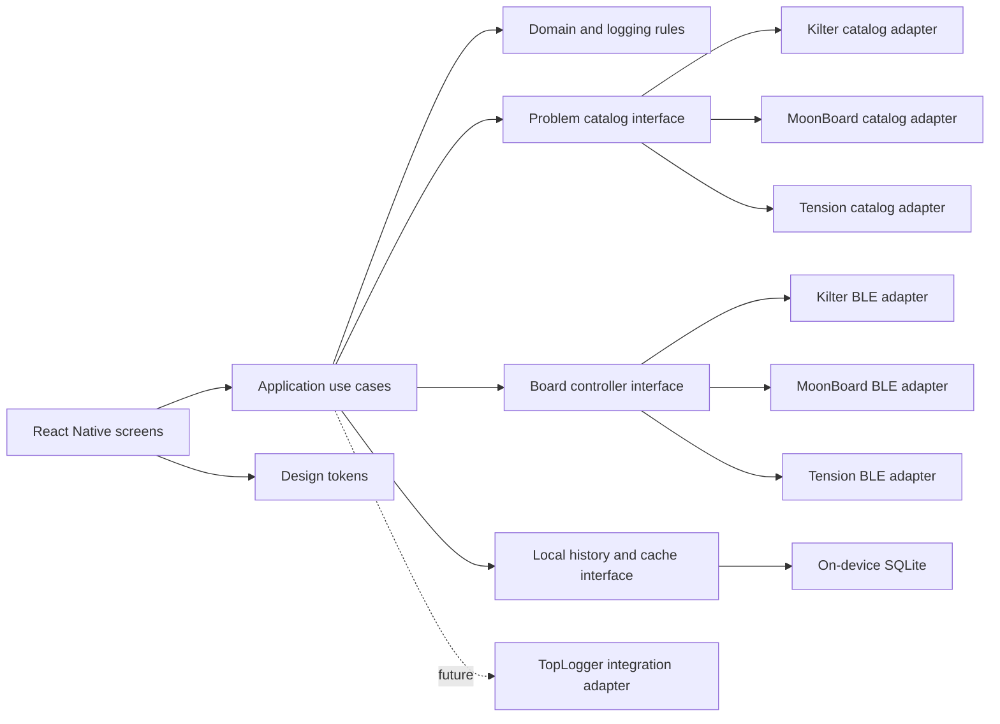

# ADR-0002: React Native architecture, board adapters, catalogs, and integration boundaries

- **Status:** Accepted architectural direction; feasibility assumptions remain open
- **Date:** 2026-11-16
- **Decision owners:** Engineering team
- **Scope:** iOS/Android MVP for MoonBoard, Kilter Board, and Tension Board
- **Related:** [ADR-0001 — updated product requirements](../ADR-0001-product-experience-and-logging-updated.md)

## 1. Context

The product needs a single mobile app on iOS and Android, BLE-driven board illumination, locally persisted climbing logs, cached manufacturer problem catalogs, and a future option to integrate with TopLogger. The external technical contracts of board controllers and problem catalogs have not been independently validated across all target hardware. We must distinguish decisions we control from assumptions about vendors.

### Inspiration and sources

- **Kilter Board app:** Reference for intuitive board controls and lighting flows.
- **Boardsesh:** Open-source cross-board architectural and UX reference. Inspect the exact repository version, license and third-party dependencies before reusing code or images. Its hosted service should **not** be treated as an authorized production API for another client without express permission.
- **TopLogger:** Reference for a compatible-feeling theme and potential eventual data/frontend integration, pending access to actual APIs, branding authorization and technology information.
- **React Native ecosystem:** Shared TypeScript application logic with platform-specific BLE bridge capability.

These are inspiration points and research targets, **not guarantees of vendor interoperability or asset reuse rights**.

## 2. Decision

Use **React Native with TypeScript** for a shared iOS/Android application, organized around explicit domain boundaries and replaceable vendor integrations. Prefer a modular monorepo. **Implement MoonBoard, Kilter Board and Tension Board adapters in the first iteration**, then validate and correct each independently on physical gym hardware. Preserve a working offline experience and implement BLE control as an asynchronous operation initiated only through an explicit **Light up** action.

### 2.1 Proposed repository boundaries

```text
apps/
  mobile/                    # React Native screens, navigation, UI shell
packages/
  domain/                    # Problem, board, logging, invariants, use cases
  application/               # Orchestration, service interfaces, state machines
  catalog-core/              # Catalog contracts, cache/update capabilities
  catalog-kilter/            # Kilter adapter (subject to access validation)
  catalog-moonboard/         # MoonBoard adapter (subject to access validation)
  catalog-tension/           # Tension adapter (subject to access validation)
  bluetooth-core/            # BLE transport, controller state and capabilities
  board-kilter/               # Kilter controller mapping/protocol
  board-moonboard/            # MoonBoard controller mapping/protocol
  board-tension/              # Tension controller mapping/protocol
  storage-local/             # SQLite schema, transactions, migrations
  design-system/             # Theme tokens, UI primitives and accessibility
  integration-toplogger/     # Future adapter contract, not required for MVP
```

Packages can initially be workspaces within one repository, **not** separately published NPM packages. Only split when boundaries have a testable reason.

### 2.2 Architecture diagram



### 2.3 Domain and persistence model

Minimal domain entities:

- `BoardManufacturer`, `BoardModel`, `BoardConfiguration` (including layout/angle/hold set where applicable).
- `Problem` with composite stable identity (`manufacturer`, provider problem ID, board/configuration version), hold placements, original grade, optional rating and metadata timestamps.
- `BoardConnection` with explicit transport state, capabilities, and last command issued by **this device**.
- `ProblemLog` or dated event records with manual attempts, reversible success attempt contribution, Top and Flash achievements, and source timestamps.
- `CatalogSyncState` per provider/configuration including last successful update and optional delta cursor or revision token.

Database: local SQLite with schema migrations and transactions. Provide uniqueness/idempotency keys for imports and future synchronization. Derive per-day and lifetime attempt totals from consistent persisted records; avoid mutable duplicate aggregates as sources of truth.

**Log rule:** `attempts = manualAttempts + successContribution`, where `successContribution` is 1 if a current logged Top/Flash achievement contributes one successful attempt, otherwise 0, subject to correctly associating the contribution with its original day. `flash => top`. Corrections must be reversible and repeated toggling idempotent. A formal state-transition test suite is required before UI wiring.

### 2.4 Bluetooth and shared-board behavior

Keep BLE transport separate from manufacturer-specific command encoding and board catalogs. The user is always shown nearby discovered boards and **manually chooses** the physical board. Never auto-select merely because a signal is strongest or a previously connected controller is available. If discoverable metadata includes model/layout/angle, populate it; otherwise let the user choose the configuration as shown on gym signage.

```ts
interface BoardController {
  discover(): Promise<DiscoveredBoard[]>;
  connect(target: DiscoveredBoard, config: BoardConfiguration): Promise<ConnectionResult>;
  getCapabilities(): BoardCapabilities;
  lightUp(problem: Problem): Promise<LightCommandResult>;
  disconnect(): Promise<void>;
}

type BoardCapabilities = {
  simultaneousConnections: 'supported' | 'unsupported' | 'unknown';
  ledStateReadback: 'supported' | 'unsupported' | 'unknown';
  canIdentifyConfiguration: boolean;
};
```

- **Two phones browse independently**; neither browsing, logging nor connecting changes the LEDs.
- Both phones may send an explicit **Light up** command when the controller supports concurrent connections; **most recent successful command wins**.
- **If simultaneous connections are unsupported, the desired fallback is last-connected phone takes over**. Implement takeover/replacement only where the actual controller allows it. Some firmware may reject the second connection rather than disconnect the first; expose a clear actionable error in that case, and do not falsely claim takeover succeeded.
- Auto-reconnect to the selected controller when the OS permits, but **never auto-resend LED commands** after reconnect or app resume. Connection changes are never lighting commands.
- Handle BLE permissions, disabled radio, timeout, unsupported configuration and interrupted connection as recoverable states.
- Report the last lighting command sent **by this device**; do not claim to know current LED state without controller acknowledgment/readback.
- Test background behavior and multi-phone contention separately for all three manufacturers.
- Provide an opt-in **diagnostic view** for gym tests: discovered name/identifier, selected configuration, connection state, operation timings, command success/failure, app/OS version, and sanitized BLE error diagnostics. Avoid unnecessary personal data or credentials.

### 2.5 Manufacturer-agnostic problem catalog and caching

Expose one app-facing contract, implemented separately by `KilterCatalog`, `MoonBoardCatalog` and `TensionCatalog`. Distinguish a catalog *board model/configuration* from a nearby *physical controller*. Provider-specific API details, authentication, pagination and hold geometry must never leak into screens or the logging domain.

```ts
interface BoardCatalog {
  listBoards(): Promise<BoardModel[]>;
  getBoard(boardId: string): Promise<BoardModel>;
  getConfigurations(boardId: string): Promise<BoardConfiguration[]>;
  listProblems(config: BoardConfiguration, query: ProblemQuery,
               cursor?: string): Promise<PaginatedResult<ProblemSummary>>;
  getProblem(problemId: ProviderProblemId): Promise<Problem>;
  capabilities(): CatalogCapabilities;
}

type CatalogCapabilities = {
  pagination: 'cursor' | 'page' | 'none';
  ratings: boolean;
  supportedGradeSystems: string[];
  deltaSync: boolean;
};
```

- **First version: simplest functional incremental loading.** Request the initial page on board selection; request further pages on scroll when supported; otherwise adapt provider responses appropriately. Avoid a complex bulk-download or delta-sync engine.
- Cache fetched problem summaries and **all opened problem details/hold mappings** in SQLite so previously viewed problems can be browsed and illuminated offline. Use a stable composite key (manufacturer, configuration, provider problem ID).
- On return, render cached results immediately, then re-fetch in the background. A refresh must not remove a user's favorites or historical records. Use delta/conditional requests only when already available and easy to implement; optimize later.
- Provider failures must preserve locally cached problems and climbing logs. Show a truthful offline/limited-results indication.
- Preserve original grades and translate between common grade scales for the simple global grade-range filter where reliable. The other MVP filter is minimum star rating. Do not treat missing ratings as zero.
- Unofficial or reverse-engineered endpoints are **permitted for initial implementation and gym testing**, behind isolated adapters; availability and commercial data rights are not established by that decision. Never treat Boardsesh's hosted API as an authorized dependency.

### 2.6 UI/UX direction and TopLogger portability

**Design intent:** The standalone application should feel familiar to climbers who use **TopLogger and Kilter Board**. Reference Kilter for board/problem selection, grading, filtering, problem visualization and the explicit lighting action; reference TopLogger for its clean climbing-oriented hierarchy and overall visual character. Boardsesh remains a reference for cross-manufacturer workflows, not a required runtime component.

**Concrete design-system requirements:**

1. Implement design tokens for light/dark surfaces, primary/accent colors, text/contrast, success/error/connection states, typography, spacing, corner radii, icons and touch targets. Keep tokens independently replaceable so a future TopLogger host can apply its own theme.
2. Deliver consistent screens for **board selection/discovery**, manual configuration, problem list (grade + rating filters), problem detail with hold map, BLE connection status, explicit **Light up** CTA, and three climbing-log controls (Attempt, Top, Flash). Preserve familiar Kilter-style scanability without pixel-copying screens.
3. Show connection and lighting feedback without blocking browsing. Problem viewing, starring, logging and changing filters must never silently illuminate holds; physical LEDs update only on **Light up**.
4. Make active Top/Flash achievements visibly toggleable, and make Attempt quick to increment with accessible edit affordance (not solely long press). Show session and lifetime attempts without crowding the problem view.
5. Use reusable components and screen-agnostic presentation models; keep provider conditionals out of shared components. Support small phones, safe areas, dynamic text, sufficient contrast and screen readers.
6. Perform an explicit **reference audit** during design: capture which UX patterns were studied from TopLogger, Kilter and Boardsesh; use original illustrations and icons unless reuse permissions have been checked. TopLogger-inspired palette is allowed as a direction, but **do not copy logos, trade dress, or imply affiliation** without approval. Do not assume Boardsesh's license automatically covers all images/assets.
7. Measure usability by fewest reasonable taps to find, light and log a problem, with cached navigation aiming for 100–500 ms and immediate feedback on touch.

**Portability objective:** Treat React Native screens as a separable presentation package, with no direct imports of vendor catalog code, BLE libraries or SQLite adapters. The app's typed use cases and versioned climb-data export/import contract are the primary transferable artifacts. A future TopLogger app on a different framework may still require a new frontend; minimize this risk through reusable domain logic, integration contracts, design tokens and documented screen behavior rather than claiming zero-port integration.

TopLogger's technology stack, external API capabilities and partnership terms remain unconfirmed. **Do not add a runtime TopLogger dependency for V1.**

### 2.7 Delivery and quality gates

1. Create a UI-only vertical slice against sample local catalog data, covering independent browsing and explicit lighting action.
2. Implement domain event/toggle semantics and deterministic unit/property tests before BLE integration.
3. Implement all three manufacturer catalog and BLE adapters in the first iteration using verified public implementation references where available, then test and correct each independently on physical gym hardware. Do not defer two manufacturers to a later product phase.
4. Implement transactional SQLite persistence, migrations, incremental fetched-page/detail caching, and simple background refresh with failure injection.
5. Test Bluetooth lifecycle: permission denial, radio disabled, disconnect, reconnect, phone locked, manual board selection, concurrent phones, and last-connection takeover where supported.
6. Measure 100–500 ms cached discovery responsiveness and 1–2 s provisional connect/light activation targets on real devices.
7. Run compatibility testing on representative iOS/Android devices and board firmware versions; define OS minimums based on actual dependency support.
8. Investigate platform-native backup; only include if implementation is materially simple. Avoid accidental claims of cross-device synchronization.
9. Keep a documented licensing inventory for reused source, assets, data and fonts.

## 3. Alternatives considered

| Option | Assessment | Decision |
|---|---|---|
| Separate native Swift/Kotlin applications | Strong platform control but doubles UI effort and drift risk | Not selected for MVP |
| React web / Capacitor wrapper | Web reuse, but native BLE bridges and lifecycle need more integration scrutiny | Superseded |
| **React Native + TypeScript** | One primary mobile codebase, native BLE integration possible, suitable open-source references | **Selected** |
| Custom backend from day one | Enables cross-device coordination, but adds accounts, cost and operational burden | Rejected for MVP |
| Rely on Boardsesh hosted API | Fast bootstrap but uncertain authorization, stability and coupling | Rejected as unapproved dependency |
| Copy a manufacturer's UI/assets | Familiar, but licensing and brand confusion risks | Recreate interaction patterns and original visual components; audit any reused assets |
| Monolith with vendor logic in screens | Quick prototype but hard to test and migrate | Rejected |
| **Interfaces + per-provider adapters** | More upfront structure, allows hardware variation and future changes | **Selected** |
| Concurrent BLE connections and last-connected takeover | Desired shared-board behavior; firmware capabilities vary | Implement concurrent control where supported; otherwise pursue last-connected takeover, with explicit unsupported feedback if firmware forbids it |
| Direct TopLogger API integration immediately | Unknown API, agreement and framework | Deferred; define integration seam |
| Automatic restoration of LEDs on reconnect | Convenient alone, disruptive in shared setting | Rejected |

## 4. Consequences

**Positive:** Reusable TypeScript domain logic, testable integrations, local-first resilience, low infrastructure cost, replaceable manufacturer providers, future integration boundaries.

**Negative:** React Native BLE dependencies and background constraints require native testing; vendor-specific LED geometry/catalog formats may differ substantially; repository modularity has some maintenance overhead; no guaranteed multi-phone lighting or universal data availability.

**Operational risk:** A usable app may be impossible for a given manufacturer without authorized catalog access even if BLE lighting is technically straightforward. Treat this as an early go/no-go spike, not a late integration task.

## 5. Assumption and validation register

These are **unverified external claims**, not accepted product facts. Risk estimates are provisional.

| ID | Assumption | Risk | Validation | Fallback / decision if false |
|---|---|---|---|---|
| A1 | Controller BLE protocols for all three manufacturers can be supported reliably | High | Implement three adapters and perform real commands on each physical board | All three remain first-iteration scope; document and fix model/firmware incompatibilities during gym testing |
| A2 | Problem catalogs, grades, ratings and hold mappings can be accessed sustainably | High | Audit official access, authentication, API terms, schema and update behavior | Limit to authorized sources/manufacturers; no catalog-dependent launch claim |
| A3 | Commercial rights allow intended use of manufacturer data and chosen third-party code/assets | High | Legal/terms review and license inventory of exact source revisions and assets | Reimplement UI; remove restricted assets/datasets; obtain permission |
| A4 | Controllers support simultaneous connections/commands from multiple phones or connection takeover | Medium–High | Connect two real phones per controller; test simultaneous commands and second-phone takeover | Try last-connected-phone takeover; if hardware refuses, display an actionable connection error and record incompatibility |
| A5 | BLE discovery can determine model and board configuration adequately | Medium | Inspect advertisements and protocol characteristics across models | Explicit manual board/model/angle/configuration selection |
| A6 | TopLogger accepts climb-record imports and/or reusable frontend packages | Medium | Confirm API contracts, authentication, stack, commercial integration agreement | Keep local app standalone and export/version domain records |
| A7 | iOS/Android BLE lifecycle supports expected lock/reconnect UX | Medium | Lifecycle test matrix by OS, phone and firmware | Reconnect on foreground; clear manual action if necessary |
| A8 | Manufacturer catalogs support pagination or efficient incremental retrieval | Medium | Inspect provider APIs, response size, cursors, pagination, conditional fetch and rate limits | Adapt full responses locally and cache viewed problems; defer optimized delta sync |
| A9 | Account-free cloud backup is sufficiently simple and reliable | Low–Medium | Small iOS/Android platform-backup spike | Local-only MVP with documented device-backup implications |

### Recommended validation order

1. **A2 + A3 (catalog access and rights)**: Investigate while building all three adapters; commercial distribution remains gated on acceptable rights.
2. **A1 + A4 + A5 (BLE protocol, multi-phone and discovery)**: Implement all three, then test lighting, takeover and manual-selection flows on target hardware.
3. **A7 (lifecycle)**: Validate usability after phone lock and reconnect.
4. **A8 + A9 (sync and backups)**: Optimize only after core end-to-end flow works.
5. **A6 (TopLogger)**: Strategic partnership/integration discovery; not an MVP prerequisite.

## 6. Architecture acceptance criteria

- MoonBoard, Kilter and Tension each have a catalog adapter and BLE adapter within the first implementation; every adapter can be replaced without changing logging domain invariants or navigation screens.
- The app exposes `listBoards`, `getBoard`, `getConfigurations`, `listProblems` and `getProblem` through a common catalog contract; pagination and API differences stay inside vendor adapters.
- Bluetooth discovery lists candidates and requires explicit manual selection; any automatic configuration detection has a manual fallback.
- Where supported, two phones can browse independently and the last explicit successful Light up command wins; when unsupported, last-connected takeover is attempted, not assumed.
- Shared React Native screens use replaceable design tokens and follow TopLogger/Kilter-inspired interaction patterns without unlicensed assets.
- A catalog provider failure leaves cached problems and locally logged attempts usable.
- No route-view or log action emits a Bluetooth LED command; only explicit **Light up** does.
- Reconnect never resends an LED command automatically.
- The log test matrix covers Top/Flash transitions, repeated toggles, manual attempt editing, day boundaries, imports, migrations and interruptions.
- Persisted records survive process termination and application upgrades under a tested migration path.
- UI remains interactive while BLE and network requests are pending.
- Controller capabilities are modeled as observed/unknown rather than falsely assuming multi-phone or state readback.
- Every production data source and reused code/asset has an approved licensing and provenance record.
- TopLogger-specific logic does not live in shared domain entities or core screens.

## 7. Implementation notes for coding agents

- Treat **ADR-0001** as normative for behavior; this ADR defines implementation boundaries.
- Do not fabricate manufacturer API endpoints, catalog keys, BLE UUIDs or command byte layouts; create explicit TODO/spike tasks until independently verified.
- Build all three integrations during the same first iteration, backed by fixture-based contract tests; validate each on physical hardware and correct provider-specific defects independently.
- Keep diagnostic logging of BLE commands and catalog sync state without collecting unnecessary personal data.
- Build usable local mock flows before enabling real Bluetooth features.
- Require a decision update before committing to a backend, proprietary data source, new account system or unapproved third-party hosted API.

## 8. Decision summary

Use **React Native + TypeScript, modular adapters for all three manufacturers in the first iteration, on-demand incremental catalog fetching with SQLite caching, manual selection after BLE discovery and explicit Light up commands**. Use TopLogger and Kilter as primary UX inspirations; keep the presentation themeable. Preserve independent browsing and aim for concurrent phone control or last-connected takeover when hardware allows. Treat vendor API rights, protocols and TopLogger compatibility as verification items, not promises.
