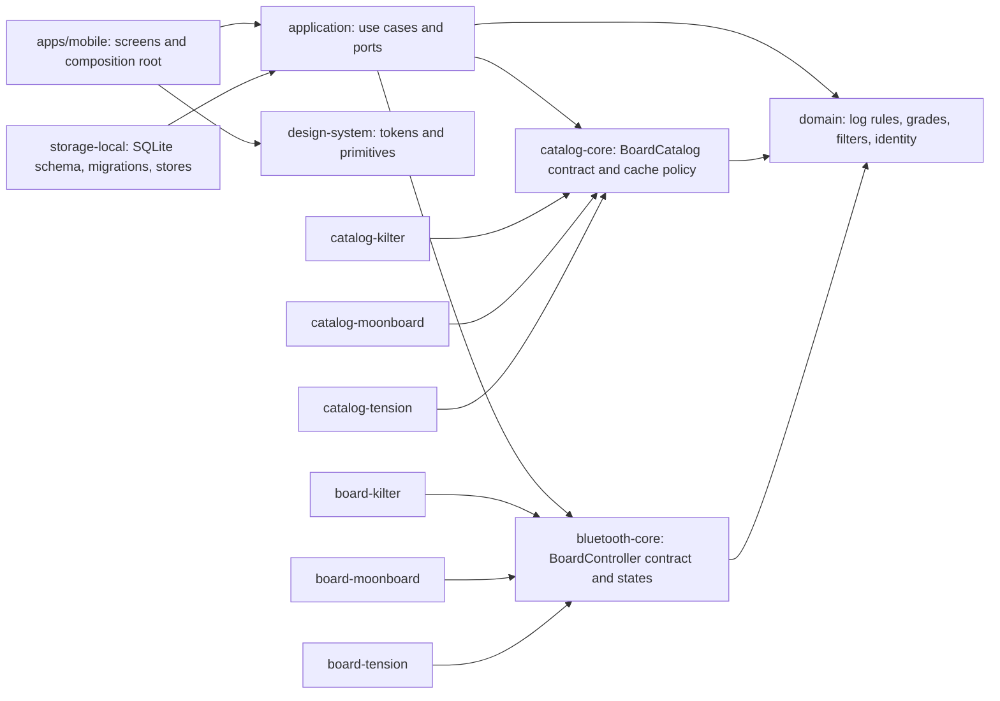

# BoardClimb: solution design

BoardClimb is a React Native (iOS and Android) companion for climbers on adjustable LED training boards (Kilter, MoonBoard, Tension). A climber standing at a shared gym wall, phone in one hand, chalky fingers, wants to find a problem, light it on the board and record attempts, without an account and without switching manufacturer apps. Product behaviour is owned by ADR-0001 (requirement IDs FR-xxx, NFR-xxx, AC-xxx); the technical boundaries by ADR-0002; the stored layout by ADR-0003; the toolchain by ADR-0004.

> Does this tap change the physical board or the climber's history, and if it does, did the climber explicitly ask for exactly that?

Every decision below answers that question: browsing never sends an LED command (FR-008), and a log action changes history only through one reversible, idempotent rule (FR-013).

## Scope

| In                                                                                                                                              | Out                                                                                                                      |
| ----------------------------------------------------------------------------------------------------------------------------------------------- | ------------------------------------------------------------------------------------------------------------------------ |
| Board-first and problem-first browsing of cached catalogs for Kilter, MoonBoard, Tension behind one `BoardCatalog` contract                     | A backend, accounts, social feeds, leaderboards, board reservations, repeated-send counting                              |
| Explicit **Light up** through a per-manufacturer `BoardController`; honest command status (pending, sent, confirmed only with readback, failed) | Claiming LED state we cannot read; auto-resend on reconnect or resume; auto-select or auto-connect to a board            |
| Local logging: manual attempts, Top, Flash, calendar-day sessions, session and lifetime totals                                                  | Cloud sync, cross-device live sync, delta sync of catalogs                                                               |
| Global grade-range and minimum-rating filters, persisted                                                                                        | Advanced filters, difficulty normalisation for soft or hard boards                                                       |
| Opt-in diagnostics for gym tests                                                                                                                | TopLogger runtime dependency (only a themeable design system and a versioned export seam are prepared, see Known limits) |
| Real vendor transports (HTTP, BLE) are separate spike work per ADR-0002 section 7: until verified, adapters say so instead of guessing          | Fabricated endpoints, UUIDs or command bytes, anywhere                                                                   |

## Components

Dependencies point inward (CODE.8): `domain` imports nothing; `catalog-core`, `bluetooth-core` and `application` import `domain`; adapter packages import their core; only `apps/mobile/src/composition` names concrete adapters. Screens import `application`, `domain` types and `design-system`, never an adapter, BLE library or SQLite (ADR-0002 section 2.6); a test reads every import and fails on a violation.

| Component                                                | Responsibility                                                                                                                                                                                                                                                         | Depends on (interfaces only)         |
| -------------------------------------------------------- | ---------------------------------------------------------------------------------------------------------------------------------------------------------------------------------------------------------------------------------------------------------------------- | ------------------------------------ |
| `domain`                                                 | Problem identity, grades and scale conversion, filter semantics, the log event model and the one function that derives totals (`summarizeLog`)                                                                                                                         | nothing                              |
| `application`                                            | Use cases (`ClimbingLog`, `ProblemBrowser`, `BoardDirectory`, `BoardSession`), the stale-while-revalidate policy (`ProblemBrowser`), ports: `Clock`, `IdGenerator`, `LogStore`, `SettingsStore`, `DiagnosticsSink`; in-memory stores for tests and the browser preview | domain, catalog-core, bluetooth-core |
| `catalog-core`                                           | `BoardCatalog` contract, `CatalogError` codes, `ProviderSource` and `ProblemCache` ports, `SourceBackedCatalog` (validates untrusted provider records), `UnverifiedProviderSource`, in-memory source and cache                                                         | domain                               |
| `catalog-kilter`, `catalog-moonboard`, `catalog-tension` | Map one provider's problem source onto `BoardCatalog`; all provider vocabulary stays here                                                                                                                                                                              | `ProviderSource` port per package    |
| `bluetooth-core`                                         | `BoardController` contract, connection and command state machines, error codes, capability model                                                                                                                                                                       | domain, `BleTransport` port          |
| `board-kilter`, `board-moonboard`, `board-tension`       | Per-manufacturer controller: discovery filter, configuration detection, hold-to-LED encoding                                                                                                                                                                           | `BleTransport` port                  |
| `storage-local`                                          | SQLite schema, forward-only migrations, `SqlLogStore`, `SqlProblemCache`, `SqlSettingsStore` over a `SqlDatabase` port                                                                                                                                                 | application ports                    |
| `design-system`                                          | Replaceable tokens (light/dark, states, type, spacing, radii, touch size) and primitives                                                                                                                                                                               | nothing                              |
| `apps/mobile`                                            | Navigation, screens, presentation models, composition root that builds concrete adapters                                                                                                                                                                               | everything, only in `composition/`   |

**Real versus stand-in.** Real here: the domain rules, storage (tested against real SQLite through Bun's built-in `bun:sqlite`; the device driver `expo-sqlite` implements the same `SqlDatabase` port), the catalog cache policy, the connection state machines. Stand-ins: the three `ProviderSource` implementations and the three `BleTransport` implementations used by the vertical slice are _sample_ sources and a _scripted_ transport, labelled as such in code and UI. Per ADR-0002 section 7 no vendor endpoint, UUID or byte layout is written until independently verified; the adapters return `provider_unverified` / `protocol_unverified` for anything that would need them. Each adapter's T.6 test (a recorded real response, or a physical board) is therefore an **open spike**, listed in Known limits; the fixture contract tests prove the shared contract, not the vendor.

## Data flow and stored layout

Full layout and reasoning: ADR-0003. Summary:

- **Browse path.** Screen asks `browseProblems(config, filters, pageCursor)`. `CachedCatalogReader` returns the cached page at once from `problems` (SQL, keyset-paged, filtered in SQL on the stored `difficulty` and `rating` columns), then calls the provider in the background; fetched pages are upserted. Refresh only inserts or updates rows; it never deletes a problem or touches `log_events`.
- **Log path.** A log action becomes one or more immutable rows in `log_events`, inserted in one transaction with a client-generated unique id (re-sending the same id is a no-op).
- **Light path.** `lightUp` reads the (cached) problem detail, calls `BoardController.lightUp`, and records the outcome on the in-memory `CommandStatus`. Nothing else in the codebase calls `lightUp`; a test with a recording controller asserts zero calls from every browse and log use case, and one from an explicit Light up (AC-1, FR-008).

Stored (SQLite, file `boardclimb.db`, `meta.schema_version` fixed at 1 before the first write):

| Table                | Key                                                                 | Holds                                                                                                                                             |
| -------------------- | ------------------------------------------------------------------- | ------------------------------------------------------------------------------------------------------------------------------------------------- |
| `log_events`         | `id` (unique), `seq` (insert order)                                 | `problem_key`, `occurred_at` (UTC ISO), `session_date` (local `YYYY-MM-DD` when logged), `time_zone` (IANA), `kind`, and `delta` or `top`/`flash` |
| `problems`           | `problem_key` = manufacturer, configuration id, provider problem id | summary columns (name, grade label and system, `difficulty`, `rating` or NULL), `detail_json` (hold mapping, once opened), `fetched_at`           |
| `catalog_sync_state` | `config_key`                                                        | last success time, next cursor, exhausted flag, optional revision token                                                                           |
| `settings`           | `key`                                                               | JSON values: global filters, selected board and configuration                                                                                     |

One `log_events` row contains everything needed to restore it alone: problem key, dates, zone, kind and payload. A problem's log can be rebuilt from its rows without the catalog.

**Derived values (CODE.10).** The log has one owner, `summarizeLog(events, today)` in `domain`: it returns manual attempts per session day, current Top and Flash, the day the success contribution counts on, session attempts for `today` and lifetime attempts. It is a pure function over rows read in the same call, so a reader sees the result _immediately_ after the write transaction commits. No table stores a total; there is no cache to drift. Callers cannot supply a total: use cases accept intents (`add one attempt`, `set top`), never counts of the derived kind. The rule is `attempts = manual + success` with `flash => top`. The achievement is the **latest** `achievement` event; the success contribution counts on the `session_date` of the event that last turned Top from off to on.

## Expected size and cost

| Collection                 | Expected | Largest allowed                                            | Shape chosen (CODE.9)                                                                                                           | Scale test                                                     |
| -------------------------- | -------- | ---------------------------------------------------------- | ------------------------------------------------------------------------------------------------------------------------------- | -------------------------------------------------------------- |
| Cached problems per device | 20,000   | 300,000 (a full Kilter catalog is the largest known order) | Indexed `(config_key, difficulty, rating, problem_key)` and keyset pagination; page size 50; filter in SQL, never load all rows | 200,000 rows inserted and a filtered page read in under 10 s   |
| `log_events` per problem   | 20       | 1,000                                                      | Read one problem's rows by `problem_key` index, fold once                                                                       | 10,000 events fold in under 2 s                                |
| `log_events` overall       | 2,000    | 100,000                                                    | Per-problem reads only; list badges for the visible page use one `IN` query, no per-row query                                   | Covered by the page-badge test                                 |
| Provider page              | 50       | 1,000                                                      | Insert in one transaction, upsert by key                                                                                        | Bulk-only fallback test inserts 20,000 rows in one transaction |

A search or page that hits its page limit says it was truncated (`nextCursor` present); it never reports "no more problems" unless the provider said so (`exhausted`).

## Identity of a run, and repeating it

There are no runs. The nearest idea is a **log action**: it has a client-generated event id; replaying the same id changes nothing. Toggle use cases are _set_ operations (`setTop(true)`), so repeating them is idempotent by construction (ADR-0001 acceptance 4). The UI computes the desired state from the derived summary and calls the set operation. A **light command** has a per-attempt id used only for status and diagnostics. A **catalog refresh** is keyed by `config_key`; two overlapping refreshes for one key share one in-flight request.

## Failure model

All failures are values with a stable code, never an empty success.

| Area      | Codes                                                                                                                                                                                                                                             | What stays healthy                                                                                                                           |
| --------- | ------------------------------------------------------------------------------------------------------------------------------------------------------------------------------------------------------------------------------------------------- | -------------------------------------------------------------------------------------------------------------------------------------------- |
| Catalog   | `provider_unverified`, `network_unavailable`, `provider_rejected`, `schema_mismatch`, `not_found`                                                                                                                                                 | Cached problems and all logs. A failed refresh shows a freshness notice, never an empty list.                                                |
| Bluetooth | `bluetooth_permission_denied`, `bluetooth_disabled`, `board_not_found`, `scan_failed`, `connection_failed`, `connection_timeout`, `takeover_unsupported`, `unsupported_configuration`, `command_rejected`, `not_connected`, `protocol_unverified` | Browsing, logging, filters.                                                                                                                  |
| Log       | `attempts_would_be_negative`, `invalid_attempt_delta`, `flash_conflicts_with_failed_attempts`, `storage_failed`                                                                                                                                   | Previously stored events. A failed write is reported; the UI never shows an unsaved total as saved.                                          |
| Storage   | `storage_corrupt`, `schema_too_new`                                                                                                                                                                                                               | The rest of the database. A row that cannot be trusted is reported, never skipped; a database from a newer app is refused, never downgraded. |

Never silent: a row that fails to parse on read raises `storage_corrupt` for that row's problem and is reported to diagnostics; it is not skipped. Never overwritten: `log_events` are append-only; a correction is a new event. Migrations are forward-only, run in a transaction, and a database with a newer `schema_version` than the app refuses to open rather than downgrade. Command status is `idle`, `pending`, `sent`, `confirmed` (only when `ledStateReadback` is `supported`) or `failed`; without readback the UI says "Last command sent from this phone".

## Observability contract

Developer diagnostics (NFR-009, ADR-0002 section 2.4) leave through one `DiagnosticsSink` port; use cases emit, the sink decides where events go (in-memory ring buffer for the diagnostic view, nothing when the mode is off). Events: `board.discovered`, `board.connection_changed` (from, to, ms), `board.command_result` (adapter, code, ms), `catalog.sync_result` (adapter, count, code, ms), `storage.migrated` (from, to). Health is the connection and catalog freshness shown in the status chip and diagnostic view. Never recorded: user names, free text, climbing history, device or BLE hardware addresses beyond a locally chosen short alias, secrets or tokens (SEC.2). A test feeds representative failures through the sink and asserts no event carries a field outside the allowed property list.

## Retention and lifecycle

Climbing history is kept until the user deletes the app (no automatic deletion). Cached problems are kept; refresh never removes a row, and rows referenced by `log_events` are never pruned. There is no cache eviction in the MVP (the largest size above is accepted, about a few hundred MB worst case, to be measured). Diagnostics are an in-memory ring of 500 events, cleared on app exit. Session boundaries use the injected `Clock`; tests move it across midnight and across a time-zone change and assert old events keep their stored `session_date`.

## Security and isolation

Untrusted: every provider response (validated into domain types at the adapter edge; unknown shape gives `schema_mismatch`), BLE advertisement names and metadata (treated as display text and hints, never as configuration truth), restored or imported data (checked for schema version and non-negative deltas). The app touches only its own SQLite file; it requests Bluetooth permission only when the user starts scanning or connecting (FR-016) and works fully without it. No credentials are stored; if a provider ever needs one, the decision is recorded in an ADR first (ADR-0002 section 7). Reused third-party code or assets need a provenance row in `docs/licensing-inventory.md` before use (NFR-011); none is used yet.

## Decisions

| ADR      | Decision                                                                                                                   | Why it is hard to reverse                                                                   |
| -------- | -------------------------------------------------------------------------------------------------------------------------- | ------------------------------------------------------------------------------------------- |
| ADR-0001 | Product behaviour, requirements FR-001 to FR-018, NFR-001 to NFR-012                                                       | Defines what users and tests expect; changes ripple into every use case and acceptance test |
| ADR-0002 | React Native and TypeScript, modular adapters for all three manufacturers, explicit Light up                               | Repository boundaries and adapter contracts are the shape of every package                  |
| ADR-0003 | Append-only event log, derived totals, SQLite layout, stable problem keys                                                  | Data already on users' phones cannot be reshaped without a migration path                   |
| ADR-0004 | Bun workspaces and `bun test`, TypeScript, Expo with a development client (Expo and Metro on Node), `bun:sqlite` for tests | Toolchain choice affects every package and native BLE module integration                    |

## Known limits

- **Vendor access is unverified.** A1, A2, A3, A4, A5 (ADR-0002 section 5) are open. The three catalog `ProviderSource` and three `BleTransport` implementations for real vendors do not exist yet; each is a spike that must end with a recorded real response or a physical-board test (T.6) before the adapter is called done. The app currently runs on clearly labelled sample data and a scripted transport.
- The grade conversion table (Font to V) is the common community table; it is shown as converted, with the published grade always visible. Providers using other systems return `difficulty: null` and are excluded from range filtering with a visible notice.
- Flash after failed attempts: the domain refuses unless the caller passes `acknowledgeContradiction`; the ADR table accepts this state, so the UI asks. Usability of that prompt is untested (ADR-0001 section 10).
- Backup and restore (A9), TopLogger integration (A6), a versioned export or import contract, minimum OS versions, latency measurements on real devices (NFR-001, NFR-002) and a licensing inventory are not implemented or measured.
- Screens have been checked in a browser rendering of the React Native app only; real iOS and Android devices were not available to this change.
- Board and layout lists (`BoardDirectory`) are not cached; only the chosen layout (saved whole in settings) and problems are. Offline, a climber can browse the saved layout but not pick a new one.
- Problem-first browsing shows the saved layout's problems (change layout from the problem list); a merged search across all manufacturers is not built. Hold geometry is unknown to the app, so the detail screen lists holds by role instead of drawing a board.
- Node 24.2 (installed here) is below React Native 0.88's stated minimum (24.3 or 22.13), and Bun is a canary build (1.4.5-canary.1). Expo and Metro run on Node, so CI must use a supported Node and a released Bun.
